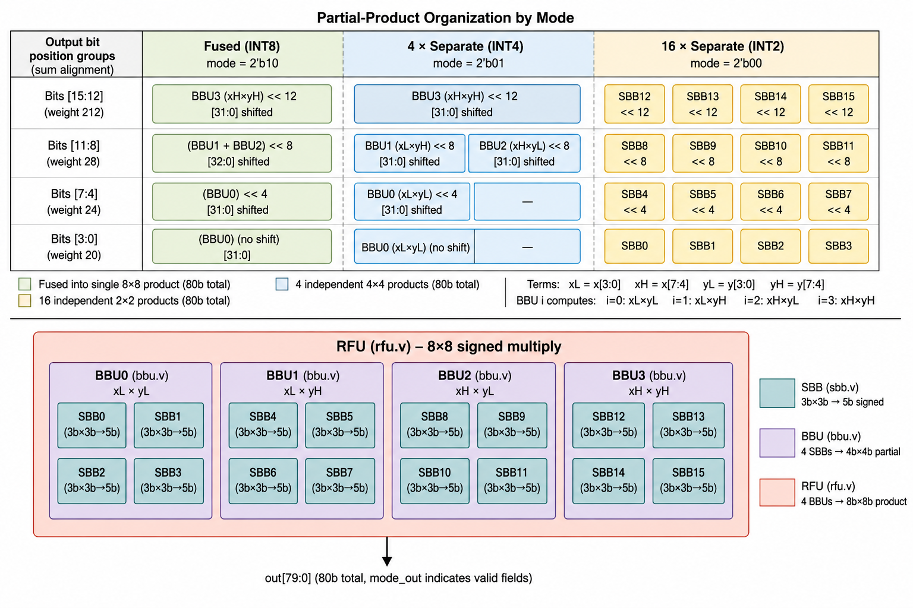
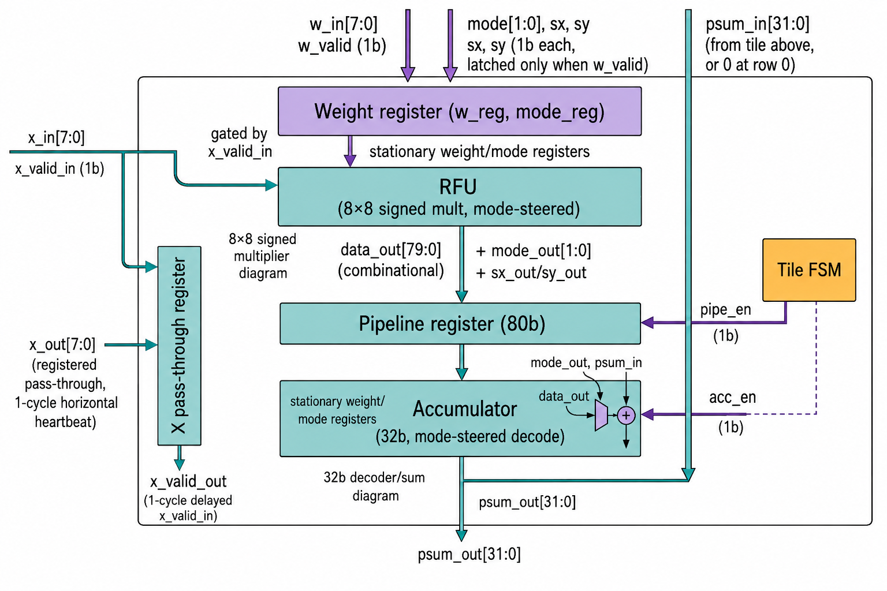
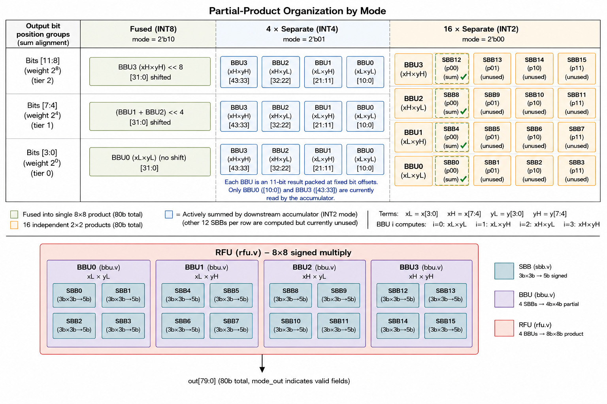
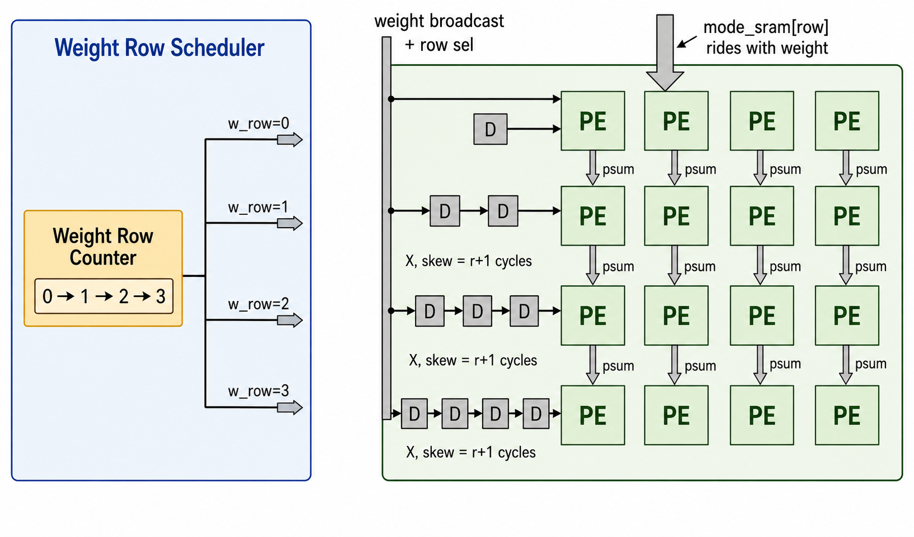

# NPU-4×4 — Precision-Scalable Systolic Neural Processing Unit

A fully custom **4×4 weight-stationary systolic MAC array** built from arithmetic primitives, supporting **per-row runtime-reconfigurable INT8 / INT4 / INT2 precision**. Every multiply-accumulate operation traces back to hand-crafted half-adders and full-adders — no DSP blocks, no vendor inference, no shortcuts. Weights stay resident in the mesh; activations stream and are reused across the array as they flow, so no tile re-reads data another tile has already consumed.

---

## Table of Contents

1. [Overview](#1-overview)
2. [Design Philosophy](#2-design-philosophy)
3. [Architecture](#3-architecture)
   - 3.1 [Top-Level: npu_4_4](#31-top-level-npu_44)
   - 3.2 [Tile: psmac_top](#32-tile-psmac_top)
   - 3.3 [Reconfigurable Functional Unit (RFU)](#33-reconfigurable-functional-unit-rfu)
   - 3.4 [Bit-Block Unit (BBU)](#34-bit-block-unit-bbu)
   - 3.5 [Signed Bit-Block (SBB) — The Arithmetic Primitive](#35-signed-bit-block-sbb--the-arithmetic-primitive)
   - 3.6 [Pipeline Register](#36-pipeline-register)
   - 3.7 [Accumulator](#37-accumulator)
   - 3.8 [Global Buffer](#38-global-buffer)
   - 3.9 [Tile FSM](#39-tile-fsm)
   - 3.10 [NPU Controller (npu_ctrl)](#310-npu-controller-npu_ctrl)
4. [Precision Modes](#4-precision-modes)
5. [Data Flow](#5-data-flow)
6. [Signal Reference](#6-signal-reference)
7. [Hardware Metrics](#7-hardware-metrics)
8. [Verification](#8-verification)
9. [Design History](#9-design-history)
10. [Applications](#10-applications)
11. [Known Limitations](#11-known-limitations)

---

## 1. Overview

| Property | Value |
|---|---|
| Array size | 4 rows × 4 columns = **16 PEs (tiles)** |
| Dataflow | Weight-stationary systolic — X streams left→right, PSUM flows top→bottom |
| Precision modes | INT8 / INT4 / INT2, **independently selectable per row** |
| Max vector length | 256 elements per dot product |
| Result width | 32-bit signed accumulator per column |
| Weight settle latency | 7 cycles (fixed) |
| Streaming latency | `vec_len + 8` cycles (skew + horizontal propagation + pipeline) |
| Arithmetic foundation | Half-adders + Full-adders (gate-level) |
| Verification | 2,588 checks passing across directed, protocol, and constrained-random tests |

The design answers a sharper version of the question the first iteration asked: **how much can you strip from a MAC array before it stops being useful — and can different rows of the same array run at different precisions in the same pass?** The answer is yes: Row 0 can hold INT8 weights for a precision-sensitive channel while Row 3 runs INT2 for a tolerant one, in the same physical mesh, on the same clock.

---

## 2. Design Philosophy

Every multiplication is decomposed into **3-bit × 3-bit partial products** assembled by signed bit-block (SBB) primitives built from half-adders and full-adders. Precision is a structural property, not a mode bit handed to a black-box multiplier — this part of the hierarchy is unchanged from the arithmetic core up.

What changed at the system level is *how data reaches that arithmetic core*. Rather than every tile owning its own weight and activation memory, a single **Global Buffer** holds all weights and inputs, broadcasts weights row-by-row into the mesh (where they stay stationary), and skews activations into the array so that each tile reuses the activation its left neighbor already computed with, one cycle later.

```
gate primitives (AND, XOR)
       │
       ▼
  ha / fa  ─── Half Adder / Full Adder
       │
       ▼
  sbb  ─────── Signed Bit-Block  (3b × 3b → 5b signed)
       │
       ▼
  BBU  ─────── Bit-Block Unit    (4b × 4b, 4 SBBs)
       │
       ▼
  RFU  ─────── Reconfigurable FU (8b × 8b, 4 BBUs, mode-steered output)
       │
       ▼
  psmac_top ── Tile / PE (weight-stationary MAC + horizontal X pass-through
       │        + vertical PSUM accumulation + tile FSM)
       ▼
  npu_4_4 ──── 4×4 systolic mesh + Global Buffer + global controller
```

Each layer adds one abstraction. Nothing is hidden. Any signal in the design is traceable back to a wire between two gates.

---

## 3. Architecture

### 3.1 Top-Level: `npu_4_4`



The top level instantiates 16 `psmac_top` tiles in a `generate` loop indexed `[row][col]` and wires them into a **mesh**, not an array of isolated units:

- **Horizontal (X) bus** — `x_h[r][c]` / `xv_h[r][c]` carry activations and their valid flags left-to-right across each row. Column `c`'s tile reads `x_h[r][c]` and drives `x_h[r][c+1]` one cycle later — the systolic heartbeat.
- **Vertical (PSUM) bus** — `psum_v[r][c]` carries the running partial sum top-to-bottom down each column. Row 0's top edge is hard-wired to zero; row `r`'s tile adds its own product to `psum_v[r][c]` and drives `psum_v[r+1][c]`.
- **Weight gating** — every tile receives the *same* broadcast weight bus (`gb_w_out[0..3]`) and the same row selector (`gb_w_row`) from the Global Buffer, but only latches when `gb_w_valid & (gb_w_row == r)` — so weight loading is a single shared bus with per-row write-enables, not 16 independent memory ports.

The bottom row's PSUM outputs, delayed one cycle to align with the accumulator's registered output, become `psum_valid_bottom[0..3]` and drain into the Global Buffer's O-Buffer.

### 3.2 Tile: `psmac_top`



Each of the 16 tiles is a PE with no local memory at all — it is purely: a stationary weight register, a horizontal pass-through register for X, and the arithmetic/accumulate pipeline. `x_in` forks into two independent paths on entry: directly (combinationally, gated by `x_valid_in`) into the RFU, and separately into the pass-through register that produces `x_out` for the next tile one cycle later — the RFU never sees the registered value, only the immediate input.

**Pipeline timing (INT8, one MAC operation as X passes through):**

```
Cycle N:    x_valid_in high → x_in registers into x_out (1-cycle horizontal
                               heartbeat) → RFU computes combinationally
                               using x_in and the stationary w_reg
Cycle N+1:  pipe_reg latches RFU output (pipe_en = x_valid_in from cycle N)
            acc_en asserted (delayed 1 cycle behind x_valid_in by the FSM)
Cycle N+1:  accumulator adds pipe_reg's data_out into psum_in → psum_out
```

The per-tile `fsm` module is the timing backbone here — it converts a single `x_valid_in` pulse into the correctly-delayed `pipe_en` / `acc_en` / `x_valid_out` triplet so that the weight-stationary MAC and the horizontal systolic pass-through stay in lockstep across all 16 tiles without any tile needing to know about its neighbors' internal state.

### 3.3 Reconfigurable Functional Unit (RFU)

Unchanged from the arithmetic core: computes one byte × byte product per cycle, steers output format based on `mode`, and gates fusion-adder inputs (`do_fuse`) to freeze unused logic and save power outside INT8 mode.

The critical addition at the system level: `mode` (along with `sx`/`sy`) is no longer a single global signal reaching every RFU identically — it arrives via `mode_reg`, latched **per tile** from the Global Buffer's per-row `mode_sram` at weight-load time (see §3.8, §4). The RFU itself doesn't know this; it just receives whatever `mode_reg` its own tile latched.

### 3.4 Bit-Block Unit (BBU)

Unchanged from the arithmetic core — 4-bit × 4-bit product from four SBB instances, same partial-product recombination pattern one level down from the RFU.

### 3.5 Signed Bit-Block (SBB) — The Arithmetic Primitive

Unchanged. Multiplies two 3-bit operands (optional sign extension on bit 2), produces a 5-bit signed product, built entirely from half-adders and full-adders.

**Gate-level composition (per tile, unchanged from the arithmetic core):**
```
SBB contains:   2 × HA + 3 × FA
BBU contains:   4 × SBB  = 8 HA + 12 FA
RFU contains:   4 × BBU  = 32 HA + 48 FA
Tile contains:  1 × RFU  = 32 HA + 48 FA  (plus pipeline + accumulator + FSM)
Array contains: 16 tiles = 512 HA + 768 FA
```



> **Note on this diagram**: only BBU0 and BBU3 are ever read by the downstream accumulator, in *both* INT4 and INT2 modes — BBU1 and BBU2 are fully computed, mode-gated, and then discarded. See [§11 Known Limitations](#11-known-limitations).

### 3.6 Pipeline Register

An 80-bit register between the RFU and accumulator, clocked on `pipe_en`. Latches the full RFU output plus `mode`, `sx`, `sy` — so the accumulator always sees the mode that was active when the RFU computed, immune to a later `w_valid` pulse changing `mode_reg` mid-flight.

### 3.7 Accumulator

A 32-bit signed accumulator per tile that interprets the pipeline register output according to the latched mode, then adds it to the PSUM value arriving from the tile above rather than a locally-cleared running sum:

```verilog
// psum_out registers each cycle: fresh sum when acc_en, cleared to 0 otherwise
always @(posedge clk) begin
    if (rst)          psum_out <= 32'b0;
    else if (acc_en)  psum_out <= psum_in + tree_out;  // tree_out: mode-steered RFU decode
    else              psum_out <= 32'b0;
end
```

This is the structural difference from a non-systolic accumulator: `psum_in` comes from the tile above (or 0 at row 0), so the final sum at row 3 is the sum of all four rows' contributions to that column — the vertical systolic reduction.

### 3.8 Global Buffer

Replaces per-tile local memory with a single shared SRAM complex:

| Memory | Purpose |
|---|---|
| `w_sram[0:255]` (32b) | 4 column-weights per row, indexed by row |
| `x_sram[0:255]` (32b) | 4 row-inputs per vector position, indexed by vec position |
| `mode_sram[0:3]` (4b) | **Per-row** `{sx, sy, mode[1:0]}` — the per-row precision store |
| `o_sram_0..3[0:255]` (32b) | One O-Buffer per output column, drained from the bottom row |

**Weight load** is a 4-cycle broadcast: cycle 0 reads `w_sram[0]` and drives `w_row=0`, cycle 1 reads `w_sram[1]` and drives `w_row=1`, etc. Every tile in the mesh sees the same weight bus every cycle but only the row matching `w_row` latches — so `mode_sram[row]` travels alongside `w_sram[row]` and each row latches its own independent precision at the exact moment it latches its own weights.

**X streaming with skew**: to make the systolic wavefront work, row `r`'s input must reach column 0 exactly `r+1` cycles after row 0's does — otherwise partial sums flowing down a column wouldn't correspond to inputs that have propagated the same horizontal distance. The Global Buffer implements this with 4 independent shift-register chains (1/2/3/4-cycle delay for rows 0/1/2/3) feeding `x_out_0..3`.



### 3.9 Tile FSM

A lightweight per-tile FSM (`fsm.v`) that converts an incoming `x_valid_in` pulse into correctly-timed `pipe_en`/`acc_en`/`x_valid_out` signals — no state beyond a 1-cycle valid-delay chain. This is what lets 16 tiles run the systolic pipeline in lockstep without any tile-to-tile control wiring; only the data buses (X, PSUM) carry information between tiles.

### 3.10 NPU Controller (`npu_ctrl`)

A single global 6-state sequencer:

```
IDLE     → wait for npu_en
LOAD_W   → 1-cycle pulse: trigger Global Buffer's weight broadcast
WAIT_W   → 7 fixed cycles: 4 cycles of GB streaming + 3 cycles for the
           rightmost column's weight to shift across the mesh
STREAM_X → 1-cycle pulse: trigger Global Buffer's skewed X streaming
WAIT_X   → vec_len + 8 cycles: 3 (skew) + 3 (horizontal) + 2 (tile pipeline)
DONE     → assert npu_valid for 1 cycle, return to IDLE
```

`pause_stream` freezes the `WAIT_X` counter and the Global Buffer's X read pointer simultaneously, letting the host inject bubbles into the activation stream without corrupting the skew relationship between rows.

---

## 4. Precision Modes

| `mode_sram[row]` bits `[1:0]` | Mode | BBU fusion | RFU fusion |
|---|---|---|---|
| `10` | INT8 | fused (4× SBB → 1 product) | fused (4× BBU → 1 product) |
| `01` | INT4 | fused (4× SBB → 1 product) | not fused — 4 independent 4b products |
| `00` | INT2 | not fused — 4 independent 2b products | not fused — 16 independent 2b products |

Because `mode_sram` is indexed **by row** and latched into each tile's `mode_reg` independently at weight-load time, all four rows can run different modes in the same pass. Row 0 can hold INT8 weights for a precision-sensitive input channel while Row 3 runs INT2 for a tolerant one — the same 16 tiles, no reconfiguration pass, no reset between rows.

> **Design note worth stating explicitly in a presentation**: because PSUM accumulates vertically down a column, a single column's final sum is the sum of contributions from potentially four different precisions if all four rows are set differently. Whether that's the intended use (per-row precision applied to four independent weight groups feeding the *same* output channel) or whether rows are meant to represent four independent output channels that just happen to share the mesh should be stated up front — know this answer before a judge asks it.

---

## 5. Data Flow

```
Step 1 — Host writes weights, inputs, and per-row mode via host_bank_sel:
  00 = W-Buffer, 01 = X-Buffer, 10 = mode_sram

Step 2 — npu_en pulses. Controller enters LOAD_W.
  Global Buffer broadcasts w_sram[0..3] one row per cycle, gated by w_row.
  mode_sram[row] rides alongside — each row's tiles latch mode_reg here.

Step 3 — WAIT_W (7 cycles): weight settles across the mesh.

Step 4 — STREAM_X pulses. Global Buffer begins skewed X streaming:
  Row 0 starts immediately, Row 1 one cycle later, Row 2 two cycles later,
  Row 3 three cycles later.

Step 5 — WAIT_X (vec_len + 8 cycles):
  Each cycle, activations move one column right; each tile computes,
  pipelines, and accumulates into the PSUM flowing down its column.

Step 6 — Bottom row's PSUM, once valid, streams into o_sram_0..3.

Step 7 — DONE: npu_valid pulses once. Host reads results via
  host_read_col + host_addr.
```

---

## 6. Signal Reference

### Top-level ports (`npu_4_4`)

| Signal | Dir | Width | Description |
|---|---|---|---|
| `clk` | in | 1 | System clock |
| `rst` | in | 1 | Synchronous reset (active high) |
| `npu_en` | in | 1 | Start inference (1-cycle pulse) |
| `mode`, `sx`, `sy` | in | 2/1/1 | **Legacy — unused.** Superseded by per-row `mode_sram`; retained on the port list from the earlier global-mode design. Tracked in [Issue: remove legacy top-level mode/sx/sy ports](#11-known-limitations). |
| `vec_len` | in | 8 | Number of elements streamed per row |
| `host_we` | in | 1 | Host write enable to Global Buffer |
| `host_bank_sel` | in | 2 | `00`=W-Buffer, `01`=X-Buffer, `10`=mode_sram |
| `host_addr` | in | 8 | Write address into selected bank |
| `host_data` | in | 32 | Write data (4 packed bytes for W/X banks) |
| `pause_stream` | in | 1 | Injects bubbles into X streaming and freezes `WAIT_X` counter |
| `host_read_col` | in | 4 | Selects O-Buffer column for readback |
| `host_read_data` | out | 32 | Readback data from selected O-Buffer |
| `npu_valid` | out | 1 | 1-cycle pulse on inference complete |
| `state_dbg` | out | 3 | Controller FSM state (0=IDLE … 5=DONE) |

### Internal mesh signals

| Signal | Description |
|---|---|
| `x_h[r][c]` / `xv_h[r][c]` | Horizontal activation bus and valid, row `r`, edge `c` |
| `psum_v[r][c]` | Vertical partial-sum bus, row edge `r`, column `c` |
| `gb_w_row` | Which row currently latches the broadcast weight bus |
| `gb_w_mode` / `gb_w_sx` / `gb_w_sy` | Per-row mode bits riding alongside the weight broadcast |

---

## 7. Hardware Metrics

### Cycle counts (from `npu_en` to `npu_valid`)

| Phase | Duration |
|---|---|
| `LOAD_W` | 1 cycle |
| `WAIT_W` | 7 cycles (fixed) |
| `STREAM_X` | 1 cycle |
| `WAIT_X` | `vec_len + 8` cycles |
| `DONE` | 1 cycle |
| **Total overhead** | **`vec_len` + ~18–19 cycles**, pending exact confirmation against a waveform dump (see §11) |

### Structural composition (arithmetic core — unchanged from the earlier design)

| Module | Count per tile | Count across 16 tiles |
|---|---|---|
| SBB (3b×3b) | 16 | 256 |
| BBU (4b×4b) | 4 | 64 |
| RFU (8b×8b) | 1 | 16 |
| HA (half-adder) | 32 | 512 |
| FA (full-adder) | 48 | 768 |

### Memory footprint (Global Buffer vs. per-tile local memory)

| | Global Buffer (this version) | Per-tile local memory (v1) |
|---|---|---|
| Weight storage | 1 × 256 × 32b = 1 KB, shared | 16 × 256B = 4 KB |
| Input storage | 1 × 256 × 32b = 1 KB, shared | 16 × 256B = 4 KB |
| Output storage | 4 × 256 × 32b = 4 KB | — |
| **Total** | **~6 KB** | **~8 KB** |

---

## 8. Verification

The testbench (`tb/npu_4_4_tb.v`) drives the DUT through **28 parametrized directed/random dot-product tests** (varying vector length and weight patterns) plus **5 dedicated protocol and edge-case scenarios**: mode-transition back-to-back, valid-signal gaps and bursts, mid-flight reset, back-to-back operations, and a constrained-random stress test. Full regression: **2,588 checks passing.**

**Layered check structure:**

| Layer | Checks |
|---|---|
| L1 — Memory | W-SRAM contents match what the host wrote |
| L2 — Weight latch | Every tile's `w_reg` matches the expected value for its row after `WAIT_W` |
| L3 — FSM timing | Controller state matches the documented cycle formula at specific cycle offsets |
| L4 — Protocol assertions | Reset exclusion (`acc_en` never high immediately after reset), pipeline validity (`x_valid_out` correctly delayed from `x_valid_in`), mode stability (`mode_reg` never drifts without a `w_valid` pulse), illegal-state detection |
| L0 — Golden model | Output-buffer contents compared cycle-accurately against an independent software dot-product model (`compute_golden_model`) |

**Key verification decisions:**

**Golden reference model** — the testbench computes expected dot products independently in software and compares against O-Buffer contents, rather than only checking intermediate signals.

**Protocol invariants over spot-checks** — mode-stability and reset-exclusion are checked as continuously-monitored assertions across the entire simulation, not just at expected transition points, so a violation anywhere is caught regardless of which directed test was running when it happened.

**Dedicated pause/skew interaction test** (Valid_Gaps_And_Bursts) — specifically exercises `pause_stream` to confirm bubbles injected mid-stream don't desynchronize the per-row skew relationship, which is the failure mode most specific to a systolic (vs. independent-tile) architecture.

---

## 9. Design History

See [`docs/EVOLUTION.md`](../EVOLUTION.md) for the full v1 → v2 narrative. Short version: the first iteration built 16 independent per-tile MAC engines, each with its own local weight/input memory and no dataflow between tiles — simple to verify in isolation, but memory-bandwidth-bound: 16 separate memory ports for what is fundamentally reused data. This version replaces that with a shared Global Buffer and weight-stationary systolic dataflow, and adds per-row reconfigurable precision, which only becomes meaningful once weights are resident in a shared mesh rather than duplicated per tile.

---

## 10. Applications

Application-level accuracy numbers (quantized-model accuracy on a real dataset) were measured against the **v1 independent-tile architecture** and have not yet been re-validated against this systolic build. Do not carry those numbers over as this architecture's own results until re-confirmed. Tracked as an open item — see §11.

---

## 11. Known Limitations

Tracked openly rather than left as prose so they're easy to point to and easy to close out:

1. **Legacy `mode`/`sx`/`sy` top-level ports are dead code.** Superseded by per-row `mode_sram`; still present on `npu_4_4`'s port list from the earlier global-mode design. Should be removed or the port list should be documented as intentionally preserved for interface compatibility.
2. **BBU1 and BBU2 are computed but never read in INT4 or INT2 mode.** In both modes, only BBU0 and BBU3's outputs reach the accumulator — BBU1/BBU2 are fully computed, mode-gated, and discarded. Worth an explicit decision: intentional packed-lane design (x/y treated as two independent narrower values) or a gap to close.
3. **Application-level accuracy numbers are stale.** Measured on v1, not yet re-validated on this systolic architecture (§10).
4. **Exact cycle-by-cycle timing (w_row transitions, per-row skew entry points, npu_valid position) needs waveform confirmation.** The phase-level formula (`vec_len + 8` for `WAIT_X`, etc.) is documented in `npu_ctrl.v` and verified by the testbench's L3 checks, but a hand-derived single-cycle timing diagram for presentation purposes should be checked against an actual VCD dump before being presented as exact.

---

## File Index

```
rtl/npu_4_4.v        — Top-level 4×4 systolic mesh + Global Buffer + controller
rtl/npu_ctrl.v       — 6-state global sequencer (IDLE/LOAD_W/WAIT_W/STREAM_X/WAIT_X/DONE)
rtl/psmac_top.v      — Tile / PE (weight-stationary MAC, horizontal + vertical dataflow, FSM)
rtl/fsm.v            — Per-tile valid/enable timing FSM
rtl/rfu.v            — Reconfigurable Functional Unit (8b×8b, 4 BBUs)
rtl/bbu.v            — Bit-Block Unit (4b×4b, 4 SBBs)
rtl/sbb.v            — Signed Bit-Block (3b×3b, ha+fa primitives) + ha + fa
rtl/pipe_reg.v       — 80-bit pipeline register
rtl/accumulator.v    — 32-bit signed accumulator, mode-steered, PSUM pass-through
rtl/global_buffer.v  — Shared SRAM: W/X/mode/O buffers + skew engine + row broadcast
tb/npu_4_4_tb.v      — Top-level testbench (28 directed/random tests + 5 protocol scenarios)
```

---

*Built from AND gates up.*